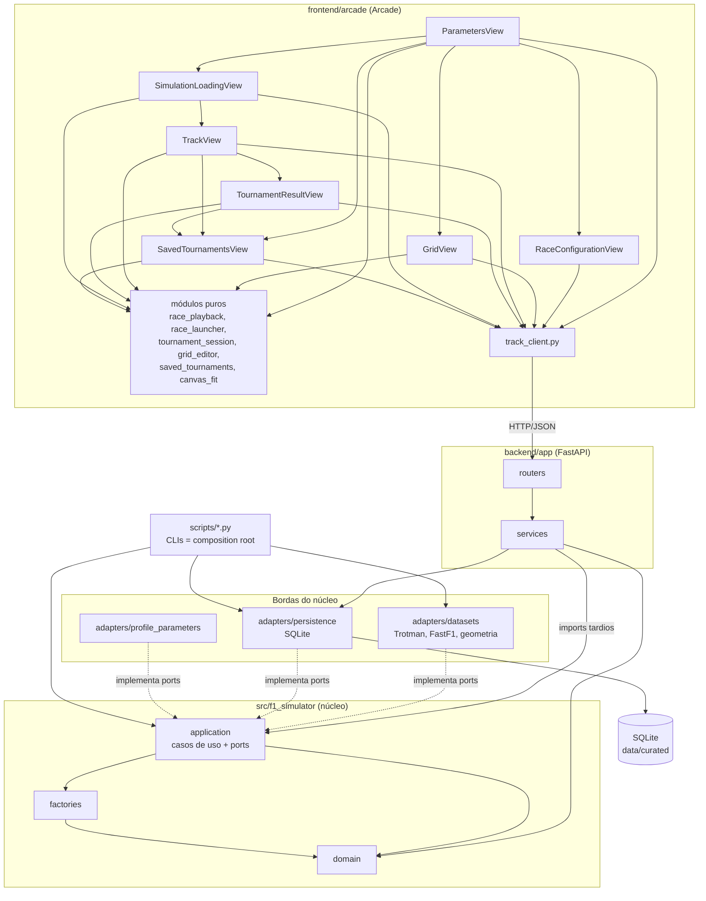
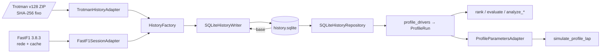

# Codebase Map

> Gerado pelo Cartographer em 2026-09-25 (commit `e86fe24`), revisado à mão em
> 2026-10-16 (`be2cdf7`) e atualizado pelo Cartographer em 2026-11-12 sobre o
> commit `94e52ab` (branch `develop`), cobrindo o diff `be2cdf7..94e52ab`.
> As contagens de arquivos e tokens do mapa original foram retiradas por não
> terem sido recalculadas. Este arquivo é um índice de navegação: em caso de
> divergência, valem `AGENTS.md`, `CONTRIBUTING.md`, os ADRs em `docs/adr/` e o
> código.

## 1. Visão geral

Simulador de Fórmula 1 da disciplina MC857 (Unicamp). Um núcleo Python determinístico
(`src/f1_simulator`) contém domínio e casos de uso. As bordas são:

- **frontend desktop** em Arcade (`frontend/arcade`), que só fala HTTP com o backend;
- **backend FastAPI** (`backend/app`), que traduz HTTP para o núcleo;
- **ETL e datasets** (`scripts/`, `adapters/`), que ingerem o Trotman v128 (Kaggle, CC0) e
  enriquecem com o FastF1 3.8.3 offline;
- **persistência SQLite** (`adapters/persistence`).

O que existe **hoje** e o que não existe:

| Área | Estado |
|---|---|
| Motor de corrida | **Um único motor: o 2D** (ADR 0011). `simulate_2d_race` em `domain/race_simulation_2d.py` + `track_space.py`: posição x,y contínua em passos de 0,05 s, ultrapassagem e colisão emergentes, velocidade física por trecho limitada por aderência e downforce (ADR 0010/0015), estado da pista, pneus (inclusive de chuva), combustível por massa, consumo e desgaste por movimento (ADR 0014), pit lane espacial (ADR 0012) com tempo de serviço por equipe, controle de prova (SC/VSC/bandeiras) e abandonos. Perfis, disputas e paradas são **heurísticos** (ADR 0008; valores em `docs/modelagem-heuristica.md`). O motor por volta (`simulate_detailed_race`, `disputes.py`, `lap_time.py`) foi removido de `src/` e está em `TOBEDEFINED/`. **Reabastecimento ainda não é executado no 2D** (`refuel_mode = False`, `TODO(motor-2d)`). `run_grid_simulation` exige geometria da pista. |
| Grid e pilotos | `POST /catalog/grid` monta o grid por sorteio, à mão ou pela largada de uma corrida histórica (`race`); atributos por arquétipo, perfis fictícios nomeados por cima e edição via `PATCH`. |
| Torneio | Sequência de etapas montada no frontend; cada etapa é um `POST /catalog/grid/run` (ou `/run/stream`, SSE com progresso por volta) sobre o grid atual, com semente de torneio derivada por etapa. Classificação por `POST /championship/standings`. **Torneio salvo** (ADR 0013): `/tournaments` guarda grid congelado, cenário e resultados; reabrir não simula, reexecutar restaura o grid e reenvia o `setup` de cada etapa. |
| Frontend | Configuração do torneio (semente copiável, voltas padrão por pista), configuração de etapa, pilotos e grid (inclui reordenação), **tela de carregamento** (grid, progresso por volta, abortar), reprodução volta a volta com controle de prova, classificação rica e decomposição de velocidade, resultado do torneio e **tela de simulações salvas**. Janela redimensionável (`canvas_fit.py`). |
| Perfis de pilotos orientados a dados | Estudos offline (ritmo por contexto, ranking, companheiros, avaliação entre eventos). Um adaptador alimenta o experimento de **uma volta**; o motor da corrida usa os atributos heurísticos, não esses perfis. |
| Combustível | Massa por carro (`domain/fuel.py`), calibrada e validada em `data/parameters/fuel-v1.json` (ADR 0009, ainda "proposta" no README dos ADRs). No 2D só a massa atua; o reabastecimento não roda. Sem o artefato, o backend usa o combustível linear de `model-v1.json`. Consumo e desgaste dinâmicos por movimento: `domain/dynamic_usage.py` (ADR 0014). |
| Pneus | Coeficientes do motor calibrado (#40, `data/parameters/model-v1.json`). Os estudos exploratórios da #63 não exportaram coeficientes. `tyre_severity` por circuito tem valores nos limites de corte (ver `docs/modelagem-heuristica.md`, §9). |

## 2. Arquitetura



Regras estruturais (ADR 0002, `AGENTS.md`):

- `domain/` só importa `domain/`. Sem I/O, sem framework, sem SQLite.
- `application/` nunca importa SQLite, FastF1 nem CSV; isso é papel das bordas.
- **Adapter** normaliza formatos externos para DTOs; **Factory** constrói objetos válidos.
  Os dois se referenciam, mas não formam ciclo porque os DTOs em `application/*_dto.py`
  são módulos-folha.
- Ports são `typing.Protocol`, em `application/ports/`.
- `arcade.View`, widgets e estado da janela **não** são fonte de verdade da simulação.
- Aleatoriedade e dependências externas são injetáveis; simulações reproduzíveis por semente.

## 3. Estrutura de diretórios

```
.
├── AGENTS.md, CONTRIBUTING.md, README.MD, proposta.md, modifications.md
├── Desenvolvimento de Simulador F1.md   # escopo, fases, restrições do produto
├── pyproject.toml, uv.lock   # Python 3.12; dependências de frontend, backend e ETL
├── run.py                # sobe docker compose, espera o backend (até ~120 s), abre o frontend
├── docker-compose.yaml   # backend (porta 8000) e frontend nos perfis linux/wslg
├── backend/              # FastAPI (app/{routers,services,schemas}), Dockerfile, entrypoint.sh; routers: catalog, championship, etl, health, history, simulation, tournaments
├── frontend/arcade/      # cliente desktop Arcade + assets/
├── src/f1_simulator/     # núcleo hexagonal
│   ├── domain/           # entidades, esquemas, regras de perfil e simulação
│   ├── application/      # casos de uso, DTOs, ports/
│   ├── factories/        # validação e construção de objetos canônicos
│   └── adapters/         # datasets/ (Trotman, FastF1, geometria), persistence/ (SQLite), profile_parameters.py
├── scripts/              # CLIs de ETL, perfis, pneus, sync do backlog
├── configs/              # planos de avaliação congelados; drivers/, cars/ e teams/ com perfis-ficticios.json (24 pilotos; 10 equipes de ritmo; 10 de execução de pit)
├── data/                 # sources/ e parameters/ (model, reference-laps, car-physics, fuel, grid-start) versionados; raw/, curated/, geometry/, simulation/ (saved-races/, saved-tournaments/) são gitignored
├── tools/                # race_viewer_template.html (visualizador do race_report.py)
├── tests/                # unittest + fixtures/ (Trotman e geometria)
├── docs/                 # 15 ADRs, modelagem, ETL, PRDs, backlog.md (espelho gerado), progresso.md
├── TOBEDEFINED/          # arquivo morto: motor por volta antigo, scripts/testes dele e protótipos (oval, RaceState); fora do pytest, nada em src/ importa de lá
└── .github/workflows/    # pull-request-rules.yml, sync-backlog.yml
```

## 4. Guia de módulos

### 4.1 `src/f1_simulator/domain/`

Convenções: dataclasses `frozen`, tuplas em vez de listas, unidades nos nomes (`_ms`, `_m`,
`_pct`, `_deg`, `_kmh`), ausência é `None` e **nunca zero**.

| Módulo | Propósito | Pontos de atenção |
|---|---|---|
| `race_data.py` | Agregado `RaceData` (circuito, corrida, pilotos, times, entradas, voltas, pits, `SourceId`, geometria opcional). IDs como `race:1141`, `driver:830`. | Geometria é opcional; nunca se infere traçado a partir de lat/long. |
| `track_geometry.py` | `TrackGeometry`, `TrackPoint`, `PitLanePoint`, `GeometryProvenance`. | X/Y **normalizados, sem unidade**; só `cumulative_distance_m` está em metros. |
| `race_simulation_2d.py` | **Único motor**: `simulate_2d_race(entrants, geometry, *, total_laps, rng, ..., dt_s=0.05, on_progress)`. Roda `track_space`, aplica pneu, combustível, clima, pista, pit lane, consumo dinâmico e controle de prova, e devolve `history`, `classification` e `race_control_events`. **Fonte de verdade da classificação.** | Cada efeito é opcional. Sem `model_parameters`+`track_params`+`compounds` não há paradas. Reabastecimento não executa (`refuel_mode = False`); `pit_loss_ms` só informa a decisão. Fluxos de aleatoriedade separados (`race-2d` vs. estratégia). Sem teste dedicado de ponta a ponta. |
| `tyres.py`, `model_parameters.py` | Penalidade por composto × `tyre_severity` (`tyre_penalty_ms(..., wear_laps=None)` aceita idade equivalente por exposição no 2D) e parâmetros versionados (`ASSUMED_WET_COMPOUNDS`). | Só a degradação é escalada pela severidade do circuito. `lap_time.py` foi removido. |
| `weather.py` | Umidade e água na pista por volta (`step_weather`, `simulate_weather`, `expand_segments`), `WeatherSegment`; passo de referência de 1,5 min. | Só evolui o estado; parâmetros `assumed`. |
| `wet_tyres.py` | Pneus de chuva (#120): aderência por classe de pneu contra a água, melhor composto, desgaste e multiplicadores de acidente e contato. | Usado pelo motor 2D e pela `HeuristicPitStrategy`; parâmetros `assumed`. |
| `track_condition.py` | Estado dinâmico da pista por volta (ADR 0015): água, temperatura do asfalto, borracha e `grip_factor` (`simulate_track_conditions`, `TrackState`). | `grip_factor` multiplica o `mu` do carro (`CarPhysics.with_grip`); parâmetros `assumed`. |
| `fuel.py` | Massa de combustível por carro (`FuelPlan`, `fuel_lap`), limite de 110 kg na carga inicial, tempo de parada por equipe (`RefuelStops`, `TeamPitOffset`). | Só ativo com `FuelPlan`. No 2D só a massa é usada; `fuel_lap` e `RefuelStops` eram do motor por volta. |
| `speed_dynamics.py` | Velocidade física por trecho (ADR 0010/0015): carro-ponto limitado por aderência e downforce (`CarPhysics`, `physics_for`, `car_pace_to_physics`), `steady_lap`, `simulate_lap_speed`, `GripLapTimes`. | `DEFAULT_CAR_PHYSICS` espelha `car-physics-v1.json`; um teste falha se divergirem. `speed_at` não existe mais. |
| `track_space.py` | Pista em faixa com largura (`build_track_space`), `CarSpaceState` e integração sub-volta multi-carro com ultrapassagem, colisão, bandeira azul e pit lane (`integrate_field`). | Largura e dimensões do carro são hipóteses `assumed`. Eixos x,y adimensionais. |
| `dynamic_usage.py` | Consumo e desgaste por movimento (ADR 0014): proxies de esforço lateral e longitudinal (`curvature_profile`, `usage_reference`, `usage_delta`). | A referência neutraliza a carga média do traçado (não conta a severidade duas vezes). Coeficientes `assumed`. |
| `pit_lane.py` | Percurso espacial dos boxes (ADR 0012): entrada, fila, serviço, saída (`build_pit_lane`, `PitLaneState`). | Distância física separada do progresso classificatório; o atalho não conta volta. Duração a partir da escala XY/m é hipótese. |
| `grid_start.py` | Fator heurístico que atenua a penalidade de largada (`initial_grid_delay_ms`). | **Órfão**: só o adaptador `grid_start_parameters_json.py` o importa; o 2D larga em filas de dois por física. |
| `random_source.py` | `RandomSource`, `SeededRandomSource` (`spawn` por chave via SHA-256), `FrozenRandomSource`, `derive_tournament_stage_random_source`. | Nunca `random` global; a semente do torneio gera fluxos distintos por etapa. |
| `championship.py` | `championship_standings`: pontos F1 25-18-…-1, abandono não pontua, desempate por média ou vitórias. | Sem ponto de volta mais rápida. |
| `race_control.py` | Autômato de SC, VSC, amarela, vermelha e relargada. | Voltas sem incidente não consomem aleatoriedade. `disputes.py` foi removido. |
| `strategy.py` | Estratégias de parada, inclusive `HeuristicPitStrategy`, que com reabastecimento decide pneus e combustível juntos (`FuelStatus`, `FuelStrategyTraits`). | `decide()` determinístico; variação por piloto (offset, combustível, `weather_switch_bias`) sorteada fora. Tem planejamento espacial de pit (`SpatialPitPlanningParameters`) para o 2D. |
| `driver_attributes.py`, `attribute_effects.py` | Atributos por arquétipo (`aggression`, `composure`) e seus efeitos. | Gestão de pneus amortecida no motor detalhado. |
| `driver_parameters.py` | `DriverPaceParameters`, `deterministic_lap_time`. | `variability_mode` só `"disabled"`. Arredonda **uma vez** com `ROUND_HALF_UP`. MAD e bootstrap não entram no tempo (evita contar carro duas vezes). |
| `driver_profile.py` | `METHOD_VERSION = "contextual-pace-v1"`, `ProfileConfig`, `PaceContext`, `assess_session`, `estimate_profiles`. | `ProfileConfig` não tem defaults. Cada volta é auditada com todas as razões de exclusão. Consistência é MAD, não sigma. |
| `context_sensitivity.py` | `ContextVariant`, `separate_stints`. | Reagrupamento exploratório; nunca relaxa exclusões de qualidade. |
| `profile_evaluation.py` | `EvaluationPlan`, `compare_profiles` (`profile-stability-v1`). | Estabilidade **em pp** entre eventos, não erro de predição. |
| `profile_reliability.py` | `BootstrapConfig(2000, 42, 0.95, 5)`, `profile_support`. | Reamostra **eventos**, não voltas. |
| `teammates.py` | `compare_teammates`, `context_reference` (`observed_context_field_median_v1`). | Gap simétrico `200*(a-b)/(a+b)`; trocar de equipe cria outro par. |
| `history.py` | Esquema tabular das 14 tabelas do Trotman (`HISTORY_SCHEMA`), `HistoricalRecord`. | `race_results` tem chave `result_id`; `laps` tem `record_number` (admite duplicatas). |
| `session_data.py` | Esquema das 10 tabelas de sessão FastF1 (`SESSION_SCHEMA`). | Relógios brutos separados, sem interpolação. |

### 4.2 `src/f1_simulator/application/`

**DTOs:** `race_data_dto.py` (`NormalizedRaceData`), `track_geometry_dto.py`.

**Ports** (`ports/`): `race_data.py` (`RaceDatasetPort`, `RaceDataWriterPort`, `RaceDataRepository`),
`track_geometry.py`, `history.py` (`HistoryDataset`, `HistoryWriter`, `HistoryRepository`),
`driver_parameters.py` (`DriverParametersProvider`).

| Caso de uso | O que faz |
|---|---|
| `race_data_ingestion.py` | `RaceDataIngestionService`: junção Adapter → Factory. |
| `etl.py` | `run_race_etl(...)`: ETL de uma corrida para SQLite mais relatório de qualidade. Geometria é opt-in; se pedida e inválida, **falha** (sem fallback). |
| `history_etl.py` | `run_history_etl(...)`: histórico completo em streaming; publica só se tudo validar. |
| `simulate_profile_lap.py` | Experimento de uma volta com um `DriverParametersProvider`. |
| `profile_drivers.py` | `ProfileRun`; só sessões `R`, com proveniência de ETL. |
| `rank_drivers.py` | Ranking de competição (1, 1, 3); indisponíveis no fim. |
| `evaluate_profiles.py`, `analyze_contexts.py`, `analyze_development.py`, `analyze_teammates.py` | Avaliações e sensibilidades. `analyze_development` **nunca lê** as sessões de validação reservadas. |
| `analyze_tyres.py`, `analyze_tyre_restarts.py`, `compare_tyre_estimators.py` | Estudos de pneus (#63), descritivos, sem coeficientes de motor. |
| `catalog.py`, `build_grid.py`, `generate_attributes.py` | Catálogo piloto@equipe e corridas do histórico, `starting_grid_pair_ids` (largada histórica), grid manual/aleatório, `reorder_grid`, atributos por arquétipo, presets fictícios e overrides manuais. |
| `run_grid_simulation.py` | `run_grid_simulation(grid, attributes, setup, *, ..., geometry, fuel_parameters, pit_entry_fraction, car_presets, team_presets, on_progress)`: valida, deriva a semente da etapa, escolhe pista e volta de referência, monta combustível, estado da pista, física e execução de pit por equipe, e chama `simulate_2d_race`. `RaceSetup(total_laps, track_id, weather, tournament_seed, stage_index)`. | Sem geometria levanta `ValueError`. `run_detailed_grid_simulation` não existe mais. |
| `saved_tournament.py` | Contrato do torneio salvo (ADR 0013): `build_saved_tournament`, `check_saved_tournament`, `tournament_summary`. | Sem I/O; `rules` e `plan` passam sem interpretação. |
| `default_laps.py` | `default_laps_for_circuit`: voltas padrão da corrida mais recente do circuito no histórico; sem histórico, regra de distância `assumed_distance_rule`. | Usado por `backend/app/services/track_geometry.py`. |
| `car_presets.py`, `team_presets.py` | `CarPreset` (`pace_offset_pct`) e `TeamPreset` (`pit_execution_factor`), presets fictícios. | Só ritmo e execução de pit; confiabilidade vem de `model-v1.json`. |
| `calibrate_model.py`, `backtest_model.py` (só a base `grid`), `reference_laps.py`, `pace_profiles.py` | Calibração do motor (#40), backtest contra a ordem de largada, voltas de referência por circuito e ritmo fora da amostra. |
| `calibrate_fuel.py` | Calibração e validação do combustível por massa (regressão de dois relógios com regressor volta × T × L) e do tempo de parada por equipe. |
| `calibrate_car_physics.py` | Estimativa de `grip_mu` e `downforce_cla_m2` do carro de referência contra as voltas de referência (grade, erro em log). |

### 4.3 `src/f1_simulator/factories/`

- `race_data_factory.py`: `RaceDataFactory.create` valida unicidades, referências e faixas; tipos exatos (bool não passa como int).
- `track_geometry_factory.py`: exige pista **fechada**, sequência contígua, progresso estritamente crescente e **exatamente um** ponto de serviço no pit.
- `history_factory.py`: campos exatamente os do esquema; `datetime` exige fuso; chaves e referências cruzadas são verificadas pelo writer na transação.

### 4.4 `src/f1_simulator/adapters/`

| Arquivo | Papel |
|---|---|
| `datasets/trotman_source.py` | Identidade imutável do dataset: v128 e SHA-256 do ZIP. |
| `datasets/acquisition.py` | `download_verified`: download atômico, idempotente por checksum. |
| `datasets/trotman.py` | `TrotmanDatasetAdapter`: uma corrida (8 CSVs) para `NormalizedRaceData`. Confere o SHA do ZIP. |
| `datasets/trotman_history.py` | `TrotmanHistoryAdapter`: 14 CSVs; contrato de colunas **exato**; ids com prefixo (`race:1141`). |
| `datasets/fastf1_sessions.py` | `FastF1SessionAdapter`: sessões 2018+, `fastf1==3.8.3` exato; única função com rede é `load_session`. |
| `datasets/mock_track_geometry.py` | Geometria reduzida (CSV + manifestos JSON com SHA-256), sem pandas/FastF1. |
| `persistence/sqlite_history.py` | `SQLiteHistoryWriter` (publicação atômica, enriquecimento idempotente por sessão) e `SQLiteHistoryRepository`. |
| `persistence/sqlite_race_data.py` | Escreve o SQLite de **uma corrida** (esquema enxuto). |
| `persistence/sqlite_race_data_repository.py` | Lê ambos os formatos (via views `race_entries` e `source_ids`). |
| `persistence/sqlite_track_geometry.py` | Geometria dentro do mesmo banco da corrida. |
| `profile_parameters.py` | `ProfileParametersAdapter`: `ProfileRun` → parâmetros por contexto exato. |
| `driver_presets_json.py`, `car_presets_json.py`, `team_presets_json.py`, `model_parameters_json.py`, `reference_laps_json.py`, `fuel_parameters_json.py`, `car_physics_json.py` | JSON versionados: perfis fictícios de pilotos, ritmo de carro e execução de pit por equipe (com o aviso), parâmetros do motor, voltas de referência, combustível e carro de referência. |
| `grid_start_parameters_json.py` | Lê `grid-start-v1.json`. **Órfão** (ver `domain/grid_start.py`). |
| `persistence/sqlite_calibration.py`, `sqlite_race_scenario.py`, `sqlite_inspection.py`, `sqlite_trotman_profiles.py` | Leitura para calibração e backtest, inspeção somente leitura e ponte com os perfis. |

### 4.4.1 `scripts/` (composition roots das CLIs)

- **ETL:** `download_trotman.py`, `list_races.py`, `ingest_trotman.py` (`--race-id` ou `--all-tables`), `ingest_fastf1.py` (`--base`, `--season`, `--rounds`, `--sessions`, `--strict`, `--without-telemetry`).
- **Pilotos:** `profile_drivers.py`, `rank_drivers.py`, `evaluate_profiles.py`, `analyze_profile_development.py`, `analyze_profile_contexts.py`, `analyze_teammates.py`.
- **Pneus:** `analyze_tyres.py`, `analyze_tyre_restarts.py`, `compare_tyre_estimators.py`.
- **Motor:** `calibrate_model.py`, `calibrate_fuel.py`, `calibrate_car_physics.py` (depois de gravar, atualize `DEFAULT_CAR_PHYSICS`), `build_reference_laps.py`, `analyze_dynamic_usage.py` (diagnóstico de consumo e desgaste). `backtest_model.py`, `race_control_frequency.py` e `race_report.py` foram movidos para `TOBEDEFINED/`.
- **Geometria:** `rebuild_fastf1_geometry.py`.
- **Manutenção:** `sync_github_backlog.py` (gera `docs/backlog.md`; requer `gh` autenticado).
- Todos inserem `src/` no `sys.path`. Resultados são publicados em pasta nova com sufixo uuid (rename atômico), nunca sobrescrevem, e recusam escrever em `data/raw`.

### 4.5 `backend/app/`

| Arquivo | Papel |
|---|---|
| `main.py` | FastAPI; routers `health`, `etl`, `history`, `simulation`, `catalog`, `championship`, `tournaments`; CORS `*`. |
| `config.py` | Caminhos fixos no container (`/data/curated`, `/data/simulation`, `/data/parameters`); artefatos de parâmetros (modelo, voltas de referência, combustível) caem em `<repo>/data/parameters` fora do container. `SAVED_RACES_DIR`, `SAVED_TOURNAMENTS_DIR`. |
| `routers/catalog.py`, `services/catalog.py` | Catálogo, grid (montagem, leitura, edição atômica de atributos e ordem), execução da corrida (síncrona e SSE) e corridas salvas. Composition root do motor: injeta geometria, combustível, presets de carro e equipe e `pit_entry_fraction` quando os artefatos existem. |
| `routers/tournaments.py`, `services/tournaments.py` | Torneios salvos (ADR 0013): gravam `saved-tournaments/<id>.json`; listam, abrem, renomeiam, excluem e fazem `restore-grid`. Usam `application/saved_tournament.py`. Não há rota de reexecução: o cliente chama `restore-grid` e reenvia o `setup` de cada etapa a `/catalog/grid/run`. Salvar dá 409 se o grid mudou depois de simular. |
| `routers/championship.py` | Classificação do torneio sobre `domain/championship.py`. |
| `routers/simulation.py` | Corrida atual, corridas salvas (criar, renomear, excluir) e geometria. |
| `routers/history.py`, `services/history.py` | Construção e inspeção do `history.sqlite`; lista de corridas. |
| `routers/etl.py`, `services/race_inspection.py`, `services/inspection.py` | Inspeção somente leitura do SQLite de corrida, via `SQLiteDatabaseInspector`. **Sem SQL.** |
| `services/track_geometry.py` | Catálogo de pistas (manifesto), geometria, `speed_profile_physical` e voltas padrão por pista (`default_laps*`). |
| `services/errors.py` | `ETLError` com `reason` → status (validation 422, source 404, storage 500). |

**Rotas:**

| Método | Caminho | Observação |
|---|---|---|
| GET | `/` | Health; usado pelo polling do `run.py`. |
| GET | `/api/etl/{tables,schema/{t},preview/{t},table/{t},database/dump}` | Inspeção de `current-race.sqlite`; `table` e `dump` sem paginação. |
| POST | `/api/history/build` | Roda `run_history_etl`; necessário antes do catálogo e do grid. |
| GET | `/api/history/{tables,schema/{t},preview/{t},reports}` | Inspeção de `history.sqlite`. |
| GET | `/api/history/races` | Corridas do histórico; `?season=` filtra. |
| GET | `/catalog` | Pares piloto@equipe do histórico. |
| POST/GET/PATCH | `/catalog/grid` | Monta (`random`, `manual`, `race`), lê e edita o grid atual (`data/simulation/current-grid.json`). PATCH aceita `{overrides?, order?}` (ao menos um; `order` é permutação exata). A resposta traz `profile` e `profiles_disclaimer`. |
| POST | `/catalog/grid/run` | Roda o grid no motor 2D; grava `current-race.json` e uma corrida salva. Aceita `setup.tournament_seed` e `setup.stage_index`. |
| POST | `/catalog/grid/run/stream` | SSE, mesmo corpo. Eventos `progress {lap,total}`, `done` ou `error {detail}`; a resposta é sempre 200 (erros vêm como evento). |
| POST | `/championship/standings` | Tabela do torneio a partir das chegadas. |
| GET | `/simulation/race` | Última corrida rodada; 404 antes da primeira. |
| GET/POST/PATCH/DELETE | `/simulation/saved`, `/simulation/saved/{id}` | Lista, salva (`name`, `race` opcionais), abre, renomeia e exclui corridas salvas. |
| GET | `/simulation/tracks` | Catálogo de 24 pistas, com `default_laps`, `default_laps_source` e `default_laps_race`. |
| GET | `/simulation/track/{circuit_id}` | Geometria e `speed_profile_physical`; aceita `circuit:18` ou `18`. |
| POST/GET | `/tournaments` | Salva `{name, rules, tournament_seed?, stages[...]}` / lista. |
| GET/PATCH/DELETE | `/tournaments/{id}` | Abre sem simular, renomeia, exclui. |
| POST | `/tournaments/{id}/restore-grid` | Torna o grid congelado o grid atual (primeiro passo da reexecução). |

### 4.6 `frontend/arcade/`

Entrada: `python -m frontend.arcade` (`__main__.py`). O frontend **não importa**
`f1_simulator` (a imagem do frontend não o contém): regras de domínio chegam por
HTTP. Os módulos marcados "puro" não importam Arcade e são testados sem janela.

| Arquivo | Papel |
|---|---|
| `parameters_view.py` | Tela inicial "Configuração do torneio": catálogo de pistas (voltas padrão vindas de `default_laps`), sequência com drag-and-drop, regras, semente (copiar e colar), botões **Pilotos e grid** e **Torneios salvos**. "Confirmar torneio" abre a `SimulationLoadingView`. |
| `race_configuration_view.py` | Configuração por etapa. Abas **Sessão** e **Clima** funcionais; Pista, Regras e Carros são placeholders. |
| `grid_view.py` | Pilotos e grid: montar (aleatório ou largada de 2024), ver perfis, editar atributos e **reordenar** (`PATCH /catalog/grid`). |
| `track_view.py` | `TrackView` (reprodução volta a volta, controle de velocidade, controle de prova, classificação rica, painéis de decomposição de velocidade, navegação do torneio). `saveable=False` esconde "Salvar" em corridas já salvas. |
| `simulation_loading_view.py` | Tela de carregamento: grid, etapa em foco, progresso por volta (SSE), abortar (vale só antes da próxima etapa). Roda o plano numa thread. |
| `saved_tournaments_view.py` | Lista única de simulações salvas (torneios e corridas): abrir, reexecutar, renomear, excluir (confirmação em dois cliques). |
| `saved_tournaments.py` (puro) | Tradução registro salvo <-> apresentação: `save_request`, `reopen`, `rerun`, `HttpTournamentClient`. `rerun` usa o `POST` síncrono (sem progresso por volta). |
| `canvas_fit.py` (puro) | Letterbox das telas de design (1280x720 e 1672x900) numa janela redimensionável; eventos de ponteiro passam por `to_logical`. |
| `clipboard.py` (puro) | Ctrl+C/Ctrl+V nos campos de semente; colar substitui o campo. |
| `speed_breakdown.py` (puro) | `SpeedBreakdownReader`: fatias da velocidade (efetiva, transiente, curva, penalidades) lidas de `speed_breakdown` e `speed_profiles` do resultado. |
| `tournament_view.py` | Resultado do torneio (`POST /championship/standings`), botão salvar (`POST /tournaments`) e atalho para as salvas. |
| `race_playback.py` (puro) | Linha do tempo por carro a partir do `history`: progresso, pneu, parada, abandono, classificação ao vivo. |
| `race_control_feed.py` (puro) | Status por volta e mensagens de controle de prova. |
| `race_launcher.py` (puro) | `SimulationPlan` → pedidos do backend (`run_setup`, `launch_plan` com progresso e cancelamento); `HttpRaceClient.run_grid` usa o SSE e cai no síncrono se a rota responder 404. |
| `tournament_session.py` (puro) | Navegação entre etapas, pedido/resposta do campeonato e `tournament_seed` (para salvar). |
| `grid_editor.py` (puro) | Rascunho de edições do grid, rótulos e passos dos atributos, opções de montagem. |
| `configuration_state.py` (puro) | `WeatherSchedule`, `TournamentRules`, `SessionConfiguration`, `ConfigurationFormData`, `SimulationPlan`. |
| `configuration_layout.py`, `track_preview.py` (puros) | Geometria de layout e da prévia. |
| `track_client.py` | HTTP com `urllib` (`F1_API_BASE_URL`, padrão `http://localhost:8000`); GET, POST, PATCH, DELETE; SSE (`run_grid_stream`); `BackendError` com o `detail` do FastAPI. Cobre grid, corridas e torneios salvos. |
| `theme.py` | Cores. |

### 4.7 `tests/`

- Execução: `uv run python -m unittest -v` (a partir da raiz). Sem as dependências, `python3 -m unittest` roda o núcleo e falha na importação dos testes que usam FastAPI. O `pyproject.toml` ainda declara `testpaths` para pytest, que não é dependência.
- Testes de GUI (`test_parameters_view.py`) exigem `ARCADE_GUI_TEST=1` e um display; ficam pulados por padrão. Três deles falhavam em 2026-10-16 (layout); não reverificado em 2026-11-12.
- `test_catalog_grid_run.py` gravava em `/data/simulation` e só passava no container; foi alterado para isolar a execução do grid (reconferir antes de assumir).
- **Áreas novas:** motor 2D e física (`test_speed_dynamics`, `test_track_space`, `test_pit_lane`, `test_spatial_pit_planning`, `test_dynamic_usage`); pista e clima (`test_track_condition`, `test_wet_tyres`); combustível (`test_fuel`, `test_fuel_strategy`); presets (`test_car_presets`, `test_team_presets`, `test_default_laps`); grid e API (`test_grid_ordering`, `test_tournament_seed_api`); torneio salvo (`test_saved_tournament`, `test_saved_listing`, `test_saved_tournaments_*`); frontend sem janela (`test_canvas_fit`, `test_clipboard`, `test_grid_view_scroll`, `test_simulation_loading_view`). Não há teste dedicado de ponta a ponta de `race_simulation_2d`. Os testes do motor por volta (`test_race_engine`, `test_lap_time_model`, `test_disputes`, `test_detailed_race_heuristics`) foram para `TOBEDEFINED/`.
- Nenhum teste acessa a rede (FastF1 é sintético; download simulado com `file://`).
- Fixtures: `trotman_v128_history/` (corrida 1141, 14 CSVs), `trotman_v128_sample/`, `trotman_v128_tracks_2025/` (24 pistas x 240 pontos; pit lane 24 x 80).
- **Helpers compartilhados** (acoplamento implícito): `history_support.py`, e exports de `test_driver_profile.py` (`CONFIG`, `record`, `lap`), `test_profile_evaluation.py` (`MemoryHistory`, `plan`), `test_tyres.py` (`rows`). Mudar esses módulos pode quebrar vários outros.

## 5. Fluxos de dados

### 5.1 Torneio pela interface

```mermaid
sequenceDiagram
    participant U as Usuário
    participant PV as ParametersView
    participant GV as GridView
    participant API as FastAPI
    participant LV as SimulationLoadingView
    participant SIM as run_grid_simulation (motor 2D)
    participant TV as TrackView
    participant SV as SavedTournamentsView

    PV->>API: GET /simulation/tracks
    U->>GV: (opcional) monta e edita o grid
    GV->>API: POST/PATCH /catalog/grid
    U->>PV: monta sequência, voltas, clima; Confirmar torneio
    PV->>API: GET /catalog/grid (ou POST, se não houver)
    PV->>LV: Confirmar torneio (thread)
    loop cada etapa
        LV->>API: POST /catalog/grid/run/stream {setup}
        API->>SIM: grid + atributos + pista + clima + geometria
        SIM-->>API: progresso por volta (SSE progress)
        SIM-->>API: history, classification, eventos, assumptions (SSE done)
        LV->>API: GET /simulation/track/{id}
    end
    LV->>TV: etapa 1 (Próxima etapa → demais); abortar volta à PV
    TV->>API: POST /championship/standings (resultado do torneio)
    TV->>API: POST /tournaments (salvar; 409 se o grid mudou)
    PV->>SV: Torneios salvos
    SV->>API: GET /tournaments/{id} (abrir, sem simular)
    SV->>API: restore-grid + POST /catalog/grid/run por etapa (reexecutar, síncrono)
```

### 5.2 ETL (offline, sem HTTP entre os componentes)



Passos: `download_trotman.py` → `ingest_trotman.py --all-tables` → `ingest_fastf1.py --base ...` →
consumo por `SQLiteHistoryRepository`. O modo `--race-id` gera outro SQLite (esquema enxuto,
com `race_entries` como tabela real) usado pelo backend.

### 5.3 Corrida pela API

`POST /api/history/build` (uma vez) → `POST /catalog/grid` → `POST /catalog/grid/run`
(ou `/run/stream`) → `data/simulation/current-race.json` e `saved-races/` → `GET /simulation/race`.
O caminho histórico antigo (`/simulation/load`, `/simulation/simulate`,
`loader.py`) foi removido antes de 2026-10-03.

## 6. Convenções

- **Idioma:** código, docstrings, mensagens e docs em português; identificadores em inglês.
- **IDs canônicos:** `entidade:<id_externo>` (`race:1124`, `driver:842`, `circuit:7`, `session:<raceId>:R`).
- **Unidades no nome** e convertidas na ingestão; tempos em ms inteiros; `\N` do Trotman vira `None`.
- **Ausência nunca é zero.** Perfis indisponíveis carregam `unavailable_reason`.
- **Escritas atômicas:** arquivo temporário no mesmo diretório e `os.replace` / `os.link`.
- **Versionamento explícito** de métodos (`contextual-pace-v1`, `profile-stability-v1`, `context-reliability-v1`) e hashes (`*_sha256`) para reprodutibilidade.
- **Aleatoriedade:** o motor sorteia só por `RandomSource` injetado e semeado (`SeededRandomSource`, fluxos por `spawn`); a semente é escolhida na borda e devolvida no resultado. Estatística offline usa `Random(seed)` local (bootstrap, semente 42).
- **Parâmetros escolhidos:** rótulo em `origin`/`source_kind` (`assumed`, `heuristic`, `estimated`, `regulation`, `calibrated`) e `parameter_version`/`method_version`. Presets em `configs/*/perfis-ficticios.json` têm `fictional_profiles: true` e `disclaimer`; nunca apresentar como medidos. `configs/cars` modela só ritmo, `configs/teams` só execução de pit.
- **Semente de torneio:** derivada por etapa (`derive_tournament_stage_random_source`); a API expõe as sementes efetivas; mesma semente e mesmos insumos dão o mesmo resultado.
- **Commits:** `tipo(escopo): resumo` no imperativo; só com autorização do usuário.
- **Backlog:** GitHub Issues é a fonte; `docs/backlog.md` é espelho gerado e **nunca se edita à mão**. Fallback: `docs/progresso.md`.
- **PRs:** só `develop` pode virar PR para `main` (workflow `pull-request-rules.yml`).

## 7. Gotchas

**Divergências entre docs e código**

1. Estudos e propostas de setembro (`planejamento-modelagem.md`, `contrato-perfil-simulacao.md`, `ranking-e-adaptador-pilotos.md`, `modelagem-pneus-inicial.md`, `perfilamento-pilotos.md`) citam `backend/app/engine/simulation.py`, `frontend/arcade/oval_track.py`, `race_view.py`, `loader.py` ou a série livre. Esses caminhos não existem mais; os documentos ganharam uma nota de estado e continuam como registro histórico.
2. Estudos de setembro reproduzem comandos com `pipenv run`; não há `Pipfile` versionado. As dependências estão no `pyproject.toml` (`uv run`).
3. `TOBEDEFINED/` é arquivo morto (≈26 arquivos): motor por volta antigo (`race_simulation.py`, `disputes.py`, `lap_time.py`), serviços, scripts e testes dele, e protótipos (`oval_track`, `race_state`, `race_view`). Nada em `src/`, `backend/`, `scripts/` ou `tests/` importa de lá; o pytest o ignora (`norecursedirs`). `docs/prds/modelagem-pilotos-heuristica.md` ainda o cita.
4. ADR 0001 e 0002 ainda mencionam Django no corpo; o ADR 0004 (FastAPI) o substitui.
5. O ADR 0006 (aceito) previa `POST /simulation/series/simulate`; a rota foi removida (PRD v3) e o mecanismo foi atualizado pelo ADR 0013 (torneio salvo). O ADR 0007 segue com contexto a revisar. Os ADRs 0009 e 0015 estão como "proposta" no README apesar de implementados. `docs/handoff-motor-2d.md` está obsoleto (diz que o motor detalhado era o padrão).
6. As 6 sessões de validação de 2024 **já foram examinadas** (18/09/2026). `configs/profile-validation-decision-2024.json` registra `reserved_metrics_examined=false` apenas para o momento em que foi escrito. Não tratar a reserva como inédita.
7. O pacote `f1_simulator` não é instalado (`PYTHONPATH=src`; `tests/__init__.py` insere o caminho).

**Comportamento não óbvio**

- **Banco histórico obrigatório:** catálogo e grid dão 404 até `POST /api/history/build`. O `entrypoint.sh` só baixa o ZIP e gera `races-index.json`.
- **Arquivos do container com dono root:** `data/curated/history.sqlite` e `data/simulation/` são criados pelo container como root no host.
- **Reload parcial:** o uvicorn recarrega `/app` (backend); mudanças em `src/` exigem reiniciar o container.
- **Voltas padrão:** vêm de `default_laps` do catálogo (`application/default_laps.py`, #107); 69 é só o fallback no frontend.
- **Reexecução de torneio salvo** sobrescreve `current-grid.json` do backend com o grid congelado e é síncrona (sem progresso por volta). Erros do SSE chegam como evento, não como status HTTP.
- **`setup["engine"]`:** o frontend ainda pode enviá-lo, mas o backend não o declara em `RaceSetupRequest` e roda sempre o 2D.
- **Órfãos:** `domain/grid_start.py`, `adapters/grid_start_parameters_json.py` e `data/parameters/grid-start-v1.json` não têm consumidor desde a remoção do motor por volta.
- **Passo do 2D:** 0,05 s; desgaste e consumo são por movimento, inclusive na pit lane; o pneu de quem abandona no meio da volta é mantido.
- **Registros do histórico** (`HistoricalRecord`) só aceitam indexação, sem `.get`.
- **Geometria vem de fixture de teste** (`data/geometry` está vazio): o compose monta `tests/fixtures/trotman_v128_tracks_2025` sobre `/data/geometry`. Geometria 2025 não é layout verificado de outra temporada, e o comprimento da volta é aproximado.
- **Docker:** os binds sobrescrevem o `COPY` da imagem; o código é sempre o do host.
- **Duas variantes de SQLite:** modo `--race-id` (esquema enxuto) e `--all-tables` (histórico). `ingest_fastf1` só aceita o histórico. `SQLiteRaceDataRepository` lê ambos; `SQLiteHistoryRepository.get_race` **recusa** corridas com carro compartilhado ou volta duplicada.
- **Valores fixos no código:** `rank_drivers.py` e `analyze_tyre_restarts.py` citam "18 eventos" nos gráficos; `analyze_tyre_restarts.py` tem sessões e pilotos fixos; `compare_tyre_estimators.interval` fixa seed 42 e 2000 réplicas.
- **Frontend:** `_OPENER` de `track_client.py` é criado no import, na thread da UI, para evitar `ssl.SSLError` no Fedora/Pyglet. A janela é redimensionável: `canvas_fit.py` escala telas de design (1280x720 e 1672x900) com letterbox e converte ponteiro com `to_logical`. A fonte "monospace" não é monoespaçada em todos os sistemas: tabelas usam um texto por coluna. Pistas repetidas compartilham configuração por `circuit_id`.
- **Testes de GUI** usam coordenadas fixas; ajustes de layout em `parameters_view.py` ou `race_configuration_view.py` os quebram.
- **CI:** não há CI de testes, lint ou tipos; só a regra de branch de origem e o sync manual do backlog (que faz push direto no branch default).
- **Licenças:** Trotman é CC0. O software do FastF1 é MIT, mas os **dados** dele seguem os termos do upstream. Dados brutos, telemetria e bancos completos ficam fora do Git.

## 8. Guia de navegação

| Para... | Toque em |
|---|---|
| Adicionar uma tabela ao histórico | `domain/history.py` (esquema) → `adapters/datasets/trotman_history.py` (`MAPPINGS`) → testes em `test_history_etl.py` |
| Adicionar um feed FastF1 | `domain/session_data.py` → `adapters/datasets/fastf1_sessions.py` → `sqlite_history.py` |
| Novo endpoint | `backend/app/routers/`, schema em `schemas/responses.py`, serviço em `services/`; lógica no núcleo, não no router |
| Alterar a regra de simulação | `domain/race_simulation_2d.py` (+ `track_space.py`, `speed_dynamics.py`, `pit_lane.py`, `dynamic_usage.py`, `track_condition.py`, `wet_tyres.py`, `fuel.py`, `race_control.py`, `strategy.py`); montagem em `application/run_grid_simulation.py`; testes em `test_track_space.py`, `test_speed_dynamics.py`, `test_pit_lane.py`, `test_dynamic_usage.py` etc. |
| Torneio salvo | `routers/tournaments.py`, `services/tournaments.py`, `application/saved_tournament.py`, `frontend/arcade/saved_tournaments*.py` |
| Parâmetros físicos, combustível ou presets | `data/parameters/*.json`, `application/calibrate_*.py`, `scripts/calibrate_*.py`, `adapters/*_json.py`, `configs/{drivers,cars,teams}/` |
| Ajustar uma heurística | `docs/modelagem-heuristica.md` (tabela "Como reajustar") |
| Mudar atributos, perfis ou o grid | `domain/driver_attributes.py`, `configs/drivers/perfis-ficticios.json`, `application/generate_attributes.py`, `application/build_grid.py` |
| Usar perfis orientados a dados no motor | `application/ports/driver_parameters.py` + `adapters/profile_parameters.py` + `domain/driver_parameters.py`; falta política para contexto ausente e referências por volta |
| Novo estudo de pneus | `application/analyze_tyres.py` (base), `scripts/analyze_tyres.py`; helpers de teste em `tests/test_tyres.py` |
| Nova tela Arcade | `frontend/arcade/`; estado e regras de apresentação em módulo puro (sem Arcade), HTTP em `track_client.py`, chamadas em thread com resultado lido em `on_update` |
| Nova fonte de dados | Exige decisão explícita e ADR: registrar versão, data, licença e transformações |
| Mudança de arquitetura ou de tecnologia | Novo ADR aceito em `docs/adr/` |
| Regenerar o backlog | `python3 scripts/sync_github_backlog.py` (nunca editar `docs/backlog.md`) |

## 9. Decisões (ADRs) e estado do produto

| ADR | Decisão |
|---|---|
| 0001 | Frontend desktop Arcade; uma `Window` com `View`s; HTTP/JSON; tempo simulado pertence ao backend. |
| 0002 | Arquitetura hexagonal (MVC rejeitado); Adapter + Factory; fonte única Trotman v128. |
| 0003 | Geometria reduzida derivada do FastF1 (24 etapas de 2025 + Interlagos/2024), só offline. |
| 0004 | FastAPI substitui Django; ETL, modelagem e motor colaboram por contratos Python, sem HTTP. |
| 0005 | Histórico completo (14 CSVs) e enriquecimento FastF1 offline em SQLite com proveniência. |
| 0006 | Sequência de corridas livres sem evento histórico obrigatório. A rota prevista foi removida; o torneio atual a realiza pelo frontend sobre `/catalog/grid/run`. |
| 0007 | (proposta) Não determinismo com parâmetros assumidos; contexto a revisar pelo grupo. |
| 0008 | Perfis, disputa, SC/VSC/bandeiras e paradas heurísticos sobre o motor calibrado da #40. |
| 0009 | (proposta) Combustível como massa por carro, reabastecimento como regra do cenário, paradas estratégicas por piloto. |
| 0010 | Motor físico de velocidade por trecho; tempo de volta emerge da curvatura (curva revisada pelo 0015). |
| 0011 | Motor 2D sub-volta com x,y contínuos; ultrapassagem e colisão emergentes. |
| 0012 | Percurso espacial de pit lane no 2D. |
| 0013 | Torneio salvo com grid congelado e resultados; reabrir sem simular ou reexecutar. |
| 0014 | Consumo e desgaste contínuos por esforço e carga de curva, parâmetros assumidos. |
| 0015 | (proposta) Velocidade de curva por aderência e downforce, com estado dinâmico da pista. |

**Backlog:** ver `docs/backlog.md` (espelho gerado). Frentes de modelagem no épico
#40: #51 pistas, #60 carros, #61 pilotos (#66, #67), #62 clima, #63 pneus. Tela de
simulação: #6 (#16, #18, #19, #21). Consumidoras: #70 e #71, filhas de #8.

**Pendências principais registradas nos docs:**

- Modelagem: composto de largada fixo, `tyre_severity` nos limites de corte e paradas em excesso em pistas severas (`docs/modelagem-heuristica.md`, §9); reabastecimento não executado no 2D; a pole vence com frequência alta. Resolvidos desde 2026-10-16: pneus de chuva (#120), aderência (#119), consumo/desgaste dinâmicos (#104), pit lane espacial (#101/#102), execução de pit por equipe (#128).
- Interface: abas Pista, Regras e Carros (placeholders); intervalo de sessão; progresso por volta na reexecução de salvos. `docs/progresso.md` ainda tem handoffs das #119/#120 já mergeadas.
- Pilotos orientados a dados: integrar ao motor; separar efeito piloto/carro.
- Decisões: revisar o ADR 0007; atualizar o status dos ADRs 0009 e 0015; decidir o destino de `TOBEDEFINED/` e dos módulos órfãos de `grid_start`.
