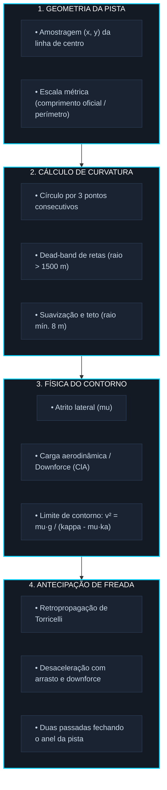

# Revisão Final: Modelagem de Curvas e Dinâmica de Velocidade

Este documento consolida a especificação, arquitetura geométrica, formulação física e comportamento da **modelagem de curvas** no simulador de Fórmula 1.

---

## 1. Visão Geral e Princípios

A modelagem de curvas é o alicerce que faz o tempo de volta e o ritmo dos carros **emergirem da geometria real do circuito**, em vez de utilizar tabelas estáticas ou tempos prescritos.

---

## 2. Geometria e Cálculo de Curvatura ($\kappa = 1/R$)

### 2.1. Escala Métrica
As coordenadas $(x_i, y_i)$ normalizadas da pista são convertidas em metros reais multiplicando pelo fator de escala:
$$\text{xy\_per\_metre} = \frac{\text{perímetro normalizado}}{\text{lap\_length\_m}}$$

### 2.2. Curvatura por 3 Pontos
Para cada ponto $B$ com vizinhos $A$ e $C$, calcula-se o raio do círculo circunscrito através do dobro da área do triângulo dividido pelo produto dos lados:
$$\kappa_{\text{raw}} = \frac{2 \cdot |(x_B - x_A)(y_C - y_A) - (y_B - y_A)(x_C - x_A)|}{\text{dist}(A,B) \cdot \text{dist}(B,C) \cdot \text{dist}(C,A)}$$

### 2.3. Filtros e Tratamento de Ruído
1. **Dead-band de Retas (`MAX_STRAIGHT_RADIUS_M = 1500 m`):** Se $R > 1500\text{ m}$ ($\kappa < 0{,}00067\text{ m}^{-1}$), $\kappa$ é forçado a $0{,}0$. Isso elimina ruídos de digitalização que geravam frenagens espúrias em retas.
2. **Suavização Móvel (`CURVATURE_SMOOTHING_POINTS = 1`):** Média ponderada entre o ponto e seus vizinhos imediatos ($3$ pontos no total).
3. **Teto de Curvatura Máxima (`MIN_CORNER_RADIUS_M = 8 m`):** Limita $\kappa \le 0{,}125\text{ m}^{-1}$, reproduzindo com exatidão o grampo mais fechado da F1 (Fairmont Hairpin em Mônaco, $\approx 45\text{--}50\text{ km/h}$).

---

## 3. Física da Velocidade de Contorno (`corner_speed_ms`)

Nas curvas, a aceleração centrípeta necessária para manter o carro na trajetória é suprida pela aderência lateral dos pneus:

$$F_{\text{centrípeta}} \le F_{\text{atrito}} \implies m \frac{v^2}{R} \le \mu \cdot N$$

A força normal $N$ é a soma do peso gravitacional e da sustentação negativa (downforce aerodinâmico):
$$N = m \cdot g + \frac{1}{2} \rho \, (C_L A) \, v^2 = m \cdot \left(g + k_a \cdot v^2\right)$$
onde $k_a = \frac{\frac{1}{2} \rho (C_L A)}{m} \approx 0{,}00345\text{ m}^{-1}$.

---

## 4. Antecipação de Freada (`_brake_limited` e `speed_ceiling`)

Para que o carro entre na curva na velocidade correta, ele deve frear antes de atingi-la.

### 4.1. Desaceleração Máxima Dinâmica
A frenagem combina a aderência dos freios sob carga aerodinâmica com o arrasto do ar ($k_d$):
$$a_{\text{brake}}(v) = \mu_{\text{brake}} \cdot \mu \cdot \left(g + k_a \cdot v^2\right) + k_d \cdot v^2$$
* Em alta velocidade ($300\text{ km/h}$), a desaceleração ultrapassa **$5\text{ g}$** devido ao forte downforce e arrasto.
* Em baixa velocidade ($80\text{ km/h}$), a desaceleração cai para $\approx 1{,}5\text{--}2\text{ g}$.

### 4.2. Algoritmo de Retropropagação (Backward Pass)
O teto de velocidade é construído retroagindo a partir do ponto final da pista até o início:
1. Para cada segmento de comprimento $ds$, a velocidade máxima permitida no ponto anterior $i$ é:
   $$v_i = \min\left(v_{\text{target}, i}, \sqrt{v_{i+1}^2 + 2 \cdot a_{\text{brake}}(v_{\text{médio}}) \cdot ds}\right)$$
2. O algoritmo executa **duas passadas** completas ao longo da volta para garantir o fechamento contínuo do circuito (a freada da curva 1 pode começar antes da linha de chegada).

---

## 5. Espaço 2D e Trajetórias (`TrackSpace`)

### 5.1. Sistema de Coordenadas Frenet $(s, d)$
Cada ponto na pista é mapeado para coordenadas cartesianas $(x, y)$ através de:
$$(x, y) = (c_x(s), c_y(s)) + d \cdot \text{scale} \cdot (\hat{n}_x(s), \hat{n}_y(s))$$
* $s$: distância percorrida ao longo da volta.
* $d$: deslocamento lateral em metros em relação à linha de centro (positivo para a esquerda, negativo para a direita).
* $(\hat{n}_x, \hat{n}_y)$: vetor normal unitário à linha de centro.

### 5.2. Limites Laterais e Ultrapassagens
* A pista possui largura métrica $W$ (ex.: $12\text{ m}$).
* O deslocamento do carro é limitado por $d \in \left[-\frac{W - w_{\text{carro}}}{2}, +\frac{W - w_{\text{carro}}}{2}\right]$.
* Em disputas e curvas, os carros buscam a linha interna ou externa, gerando ultrapassagens emergentes pela geometria e espaço disponível.

---

## 6. Decomposição de Telemetria (`SpeedBreakdown`)

A velocidade instantânea de cada carro é exibida e decomposta em tempo real:
* **Teto da Geometria:** Determinado exclusivamente pelo raio da curva e ponto de frenagem.
* **Fatia de Pneu e Combustível:** Penalidades de peso e desgaste atuam proporcionalmente sobre a capacidade de aceleração e velocidade de contorno.
* **Fatia de Clima:** Modula diretamente o $\mu$ de aderência, afetando drasticamente curvas e frenagens sem alterar a velocidade máxima terminal em retas longas.

Substituindo $N$ na equação de atrito e isolando $v$:
$$v^2 \cdot \left(\kappa - \mu \cdot k_a\right) \le \mu \cdot g$$

### Equação de Velocidade Máxima de Curva:
$$v_{\text{curva}} = \min \left(v_{\max}, \sqrt{\frac{\mu \cdot g}{\kappa - \mu \cdot k_a}}\right)$$

* **Curvas Lentas ($\kappa \gg \mu \cdot k_a$):** O atrito mecânico dos pneus domina. O raio $R$ dita a velocidade (ex.: Mônaco a $50\text{ km/h}$).
* **Curvas de Alta ($\kappa \approx \mu \cdot k_a$):** O downforce aumenta o peso aparente do carro com o quadrado da velocidade, permitindo fazer curvas velozes de pé cravado (ex.: Copse em Silverstone, Eau Rouge em Spa).
